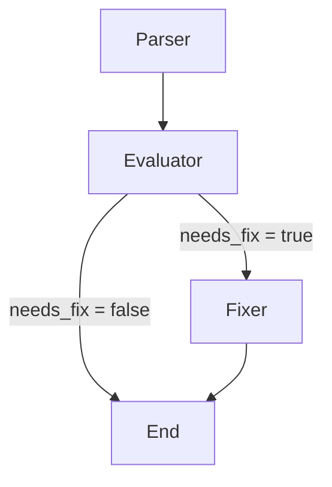

# Automation Code Validator

A Flask dashboard for analyzing browser automation logs with a LangGraph workflow. It detects Cypress, Selenium, or Playwright and the test language, asks a locally hosted Ollama model to evaluate anomalies, and generates a fix suggestion when the evaluation indicates that a correction is needed.

---

---

## Technology Stack

- **Python 3.10+** for the application and processing pipeline.
- **Flask** for the web dashboard and HTTP API.
- **LangGraph** for the Parser, Evaluator, and conditional Fixer workflow.
- **Pydantic** for anomaly and evaluation data schemas.
- **Ollama** for local language-model inference through `/api/tags` and `/api/generate`.
- **Requests** for server-side HTTP communication with Ollama.
- **HTML, JavaScript, and Tailwind CSS** for the dashboard; Server-Sent Events (SSE) stream inspection progress to the browser.
- **unittest** for automated tests; **Ruff** is included in the project dependencies for linting.

## Supported Frameworks and Languages

| Framework | Supported languages |
| --- | --- |
| Cypress | JavaScript |
| Selenium | Java, JavaScript, Python |
| Playwright | Java, JavaScript, Python |

The parser detects the framework and language from explicit log metadata, framework-specific log signatures, source file extensions, and available source code. Cypress defaults to JavaScript when no language signal is present. If evidence is insufficient for another stack, its value is `Unknown` rather than guessed. When a folder is configured, each `.txt` log is processed independently; files are not concatenated, so each report block keeps its own framework and language.

## Requirements

- Python 3.10 or later.
- Ollama installed and running locally.
- At least one model pulled into Ollama and available from `http://localhost:11434/api/tags`.

## Installation

From the project root, create and activate a virtual environment, then install the runtime dependencies:

```powershell
python -m venv .venv
.\.venv\Scripts\Activate.ps1
python -m pip install flask langgraph pydantic requests ruff
```

The declared project dependencies are listed in `pyproject.toml`.

## Configuration

Application settings are stored in `conf/config.json`:

```json
{
  "ai": {
    "preferred_model": "ollama"
  },
  "ollama": {
    "host": "http://localhost:11434",
    "model": "your-installed-model:tag"
  },
  "files": {
    "input_path": "data/fixtures"
  },
  "prompts": {
    "evaluator": "src/agents/prompts/evaluator_prompt.txt",
    "fixer": "src/agents/prompts/fixer_prompt.txt"
  }
}
```

- `ai.preferred_model`: only `ollama` is currently integrated. GPT-4o and Claude are not supported by the processing pipeline.
- `ollama.host`: the base URL of the local Ollama server, without `/api/tags`. The settings UI can test the URL and retrieve installed models. Only localhost or a loopback address is accepted.
- `ollama.model`: the selected installed model name.
- `files.input_path`: an absolute path or a path relative to the project root. A directory is scanned for `.txt` files directly inside it; subdirectories are not scanned. A single file path is also accepted.
- `prompts.evaluator` and `prompts.fixer`: absolute paths or project-root-relative paths to the prompt files.

The **AI Configuration**, **Path Inspection**, and **Edit Prompts** tabs load and save these settings. Evaluator and Fixer prompts can be edited and saved independently.

## LangGraph Workflow



1. **Parser** analyzes the input logs and produces anomalies and initial metrics.
2. **Evaluator** evaluates each detected anomaly with the configured Evaluator prompt and Ollama model.
3. **Fixer** runs only when the Evaluator returns `needs_fix=true`. It generates a selector/code suggestion; it does not modify source files automatically.

Evaluator output is schema-validated, and `needs_fix` is derived from the validated classification rather than trusted directly from the model. Parser evidence takes precedence for infrastructure errors and explicit selector ambiguity. Network timeouts, element lookup timeouts, and generic timeouts are distinguished; a generic timeout is `UNCLASSIFIED` until there is enough evidence. The Fixer receives only anomalies classified as `ERR_AMBIGUOUS_SELECTOR` or `FLAKY_SELECTOR`, together with the evaluator reasoning and recommendation. If the context does not support a safe exact change, it returns `NO_SAFE_FIX`.

Each input log file is processed independently so its detected framework and language stay associated with its anomalies. The console reports the framework on the processing line, for example:

```text
[PARSER] Processing 8/9: selenium_javascript.txt | Framework detected: Selenium.
```

The saved JSON is an array with one block per input file, including files with no anomalies. Each block contains `file_name`, `file_path`, `framework_type`, `language`, `anomaly_count`, `needs_fix`, and nested `anomalies`. The `framework` key is also included as a compatibility alias. A block looks like this:

```json
[
  {
    "file_name": "selenium_javascript.txt",
    "file_path": "data/fixtures/selenium_javascript.txt",
    "framework_type": "Selenium",
    "framework": "Selenium",
    "language": "JavaScript",
    "anomaly_count": 1,
    "needs_fix": true,
    "anomalies": [
      {
        "id": "ERR_ELEMENT_NOT_FOUND_1",
        "description": "Element not found",
        "status": "fix_suggested",
        "file_path": "data/fixtures/selenium_javascript.txt",
        "corrected": false,
        "needs_fix": true,
        "evaluation": {
          "anomaly_id": "ERR_ELEMENT_NOT_FOUND_1",
          "classification": "FLAKY_SELECTOR",
          "reasoning": "The locator is unstable.",
          "needs_fix": true,
          "recommendation": "Use a stable locator."
        },
        "fix_suggestion": "By.id(\"login-submit\")"
      }
    ]
  }
]
```

Anomaly details remain nested under their source file. The log file path is included in results; `.txt` log contents are not treated as source code by the Fixer.

## Run the Dashboard

On Windows, run `server/start_server.cmd`. It changes to the project root, checks Python, Flask, and port 5000, starts the dashboard, and opens `http://127.0.0.1:5000` in a browser.

Alternatively, run this from the project root:

```powershell
python web_ui/app.py
```

The web server uses port 5000. Stop any previous server process if that port is already in use.

To run the validation pipeline from the terminal without the web UI:

```powershell
python src/main.py --cli
```

## Inspection and Cancellation

Click **Run Perform Inspection** to run the configured input through the pipeline. The UI reads the input files, checks that Ollama is responding and has an installed model, then streams progress events for file loading and graph stages. If Ollama is unavailable or has no models, the run stops before sending the logs to the graph.

The console shows an indeterminate activity indicator and elapsed time. It does not show a percentage because Ollama generation is not exposed as token-level progress.

Click **Stop** to request cancellation. The active Ollama HTTP response is closed, the graph stops, and no partial result report is saved. A request already completed by Ollama cannot be recalled, but the application will stop processing its result when cancellation is received.

When inspection completes, the application writes a JSON summary to `logs/` using this filename pattern:

```text
verification_summary_YYYYMMDD_HHMMSS.json
```

Each nested anomaly includes its `id`, `description`, `file_path`, `needs_fix` decision, and an `evaluation` object with the classification, reasoning, and recommendation. The `fix_suggestion` field contains the Fixer output when one was generated. The `status` is `fix_suggested`, `fix_needed`, `evaluated`, or `detected`, depending on the available results. `corrected` remains `false` because the application does not apply suggestions to source files automatically; a generated suggestion is not the same as an applied correction.

## Logs and API

The **Visualization Logs** panel lists JSON reports from `logs/`, newest first. It loads five entries at a time and fetches more as the list is scrolled.

Main dashboard routes:

- `POST /api/run-stream`: runs an inspection and streams progress events using SSE.
- `POST /api/run-cancel/<run_id>`: requests cancellation of an active streamed inspection.
- `POST /api/run`: runs an inspection and returns a JSON response without SSE.
- `GET /api/logs?page=1`: returns up to five log entries and the total count.
- `GET /api/logs-details/<filename>`: returns the contents and metadata of a log report.
- `GET` and `POST /api/prompts`: load or save the configured prompt files.
- `GET` and `POST /api/config/input-path`: read or update `files.input_path`.
- `GET` and `POST /api/config/ollama`: read or update the preferred provider, Ollama URL, and model.
- `GET /api/ollama/models`: retrieves available Ollama models from `/api/tags`.

## Tests

Run the test suite from the project root:

```powershell
python -m unittest discover -s src/tests -v
```

Tests cover parsing, configuration, prompt paths, input-folder inspection, SSE events and cancellation, Ollama readiness, graph progress, and log pagination.

## Project Structure

```text
conf/config.json                 Application configuration
src/main.py                      LangGraph workflow and CLI entry point
src/agents/nodes/                Parser node
src/agents/prompts/              Evaluator and Fixer prompts
src/core/                        Graph state and data schemas
src/utils/                       Configuration, technology detection, Ollama client, and prompt loader
src/tests/                       Automated tests
web_ui/app.py                    Flask application and API
web_ui/templates/index.html      Dashboard UI
logs/                            Generated JSON reports
server/start_server.cmd          Windows server launcher
```
