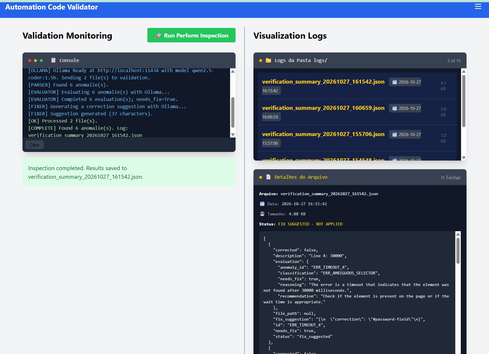

Automation Code Validator

An intelligent, AI-powered Flask dashboard driven by an orchestrator agent workflow to analyze, classify, and suggest fixes for browser automation logs.
By leveraging local LLM execution and stateful workflows, it automatically identifies framework environments (Cypress, Selenium, Playwright), isolates anomalies, and structures targeted debugging recommendations.

---

---

🚀 Key Features & Business Value
```
• Stateful Agentic Workflow: Built with LangGraph to process logs through a strict linear pipeline with conditional edge execution
(Parser ➔ Evaluator ➔ Fixer).
• Privacy-First Local AI: Seamlessly integrates with Ollama (/api/generate) to run open-source LLMs locally, ensuring data compliance
 and zero API costs.
• Real-Time Inspection Streaming: Utilizes Server-Sent Events (SSE) via Flask to push asynchronous backend validation tokens and
 graph stages straight to the UI.
• Deterministic Validation: Combines Pydantic schemas with heuristics to override raw LLM outputs, guaranteeing precise event tracking
and safe structural classification.
```

🛠️ Technology Stack
```
• Backend Architecture: Python 3.10+, Flask, Requests.
• AI & Orchestration: LangGraph, Pydantic, Ollama.
• Frontend Experience: HTML5, JavaScript (Async Stream Fetch), Tailwind CSS.
• Quality Assurance & Tooling: Unittest (Automated testing), Ruff (Fast linting).
```
📊 Supported Frameworks & Ecosystem
```
Framework   Languages Supported	        Default / Fallback Behavior
Cypress	    JavaScript   	            Defaults to JS if no explicit metadata is present.
Selenium    Java, JavaScript, Python	Strict mapping based on log signatures & file extensions.
Playwright  Java, JavaScript, Python	Detects environment signatures; avoids guessing unknown stacks.
```
Note: Each log file (.txt) is scoped and processed independently inside the workflow to ensure data isolation and prevent framework context pollution.

📐 Agentic Architecture (LangGraph Workflow)
```
flowchart TD
    Parser[1. Log Parser Node] --> Evaluator[2. AI Evaluator Node]
    Evaluator -->|needs_fix == true| Fixer[3. AI Code Fixer Node]
    Evaluator -->|needs_fix == false| End((End Process))
    Fixer --> End
```	
1. Parser: Extracts anomalies, isolates infrastructure errors, and detects environment profiles.
2. Evaluator: Evaluates log anomalies using structured prompts. Outputs strict JSON verified via Pydantic.
3. Fixer: Executes only under ERR_AMBIGUOUS_SELECTOR or FLAKY_SELECTOR classifications. Generates exact non-destructive locator recommendations (NO_SAFE_FIX applied if context is ambiguous).

💻 Getting Started

1. Installation

Clone the repository and install the runtime dependencies inside a virtual environment:
```
python -m venv .venv
.\.venv\Scripts\Activate.ps1
python -m pip install flask langgraph pydantic requests ruff
```
2. Configuration

Adjust your environment parameters inside conf/config.json:
```
{
  "ai": { "preferred_model": "ollama" },
  "ollama": {
    "host": "http://localhost:11434",
    "model": "your-installed-model:tag"
  },
  "files": { "input_path": "data/fixtures" },
  "prompts": {
    "evaluator": "src/agents/prompts/evaluator_prompt.txt",
    "fixer": "src/agents/prompts/fixer_prompt.txt"
  }
}
```
3. Execution

To run the Flask Dashboard UI:
```
python web_ui/app.py
```
Alternatively, use the automated Windows batch script launcher: server/start_server.cmd.
To run the pipeline strictly from the command line interface (CLI):
```
python src/main.py --cli
```
🧪 Testing and Code Quality

Run the comprehensive unit test suite covering schema serialization, graph state transitions, client timeouts, and SSE stream chunking:

python -m unittest discover -s src/tests -v

📁 Project Directory Structure

```text
conf/config.json                 # Application configuration profile
src/main.py                      # Core LangGraph compilation and CLI handler
src/agents/nodes/                # Independent agent logic (Parser, Evaluator, Fixer)
src/agents/prompts/              # Externalized plain-text system prompts
src/core/                        # Shared graph states and Pydantic schemas
src/utils/                       # Tech detection engine, HTTP clients, configuration loaders
src/tests/                       # Automated unit tests and mock fixtures
web_ui/app.py                    # Flask server endpoints and SSE event emitters
web_ui/templates/index.html      # Responsive Tailwind dashboard interface
logs/                            # Context-isolated inspection JSON summaries
server/start_server.cmd          # Native Windows orchestration script
```

