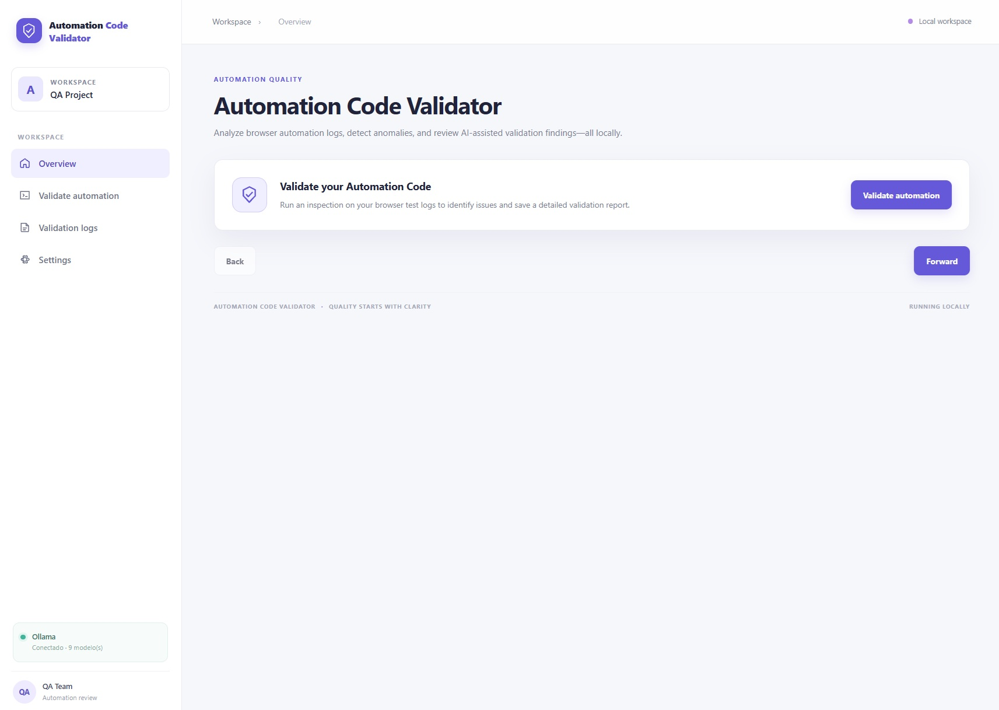
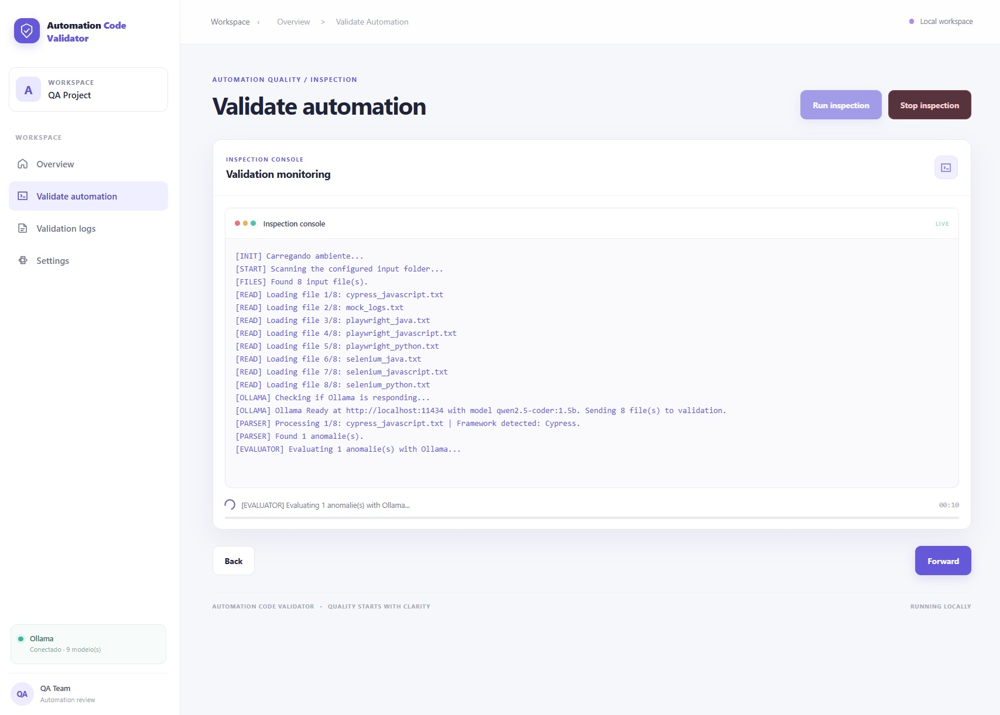
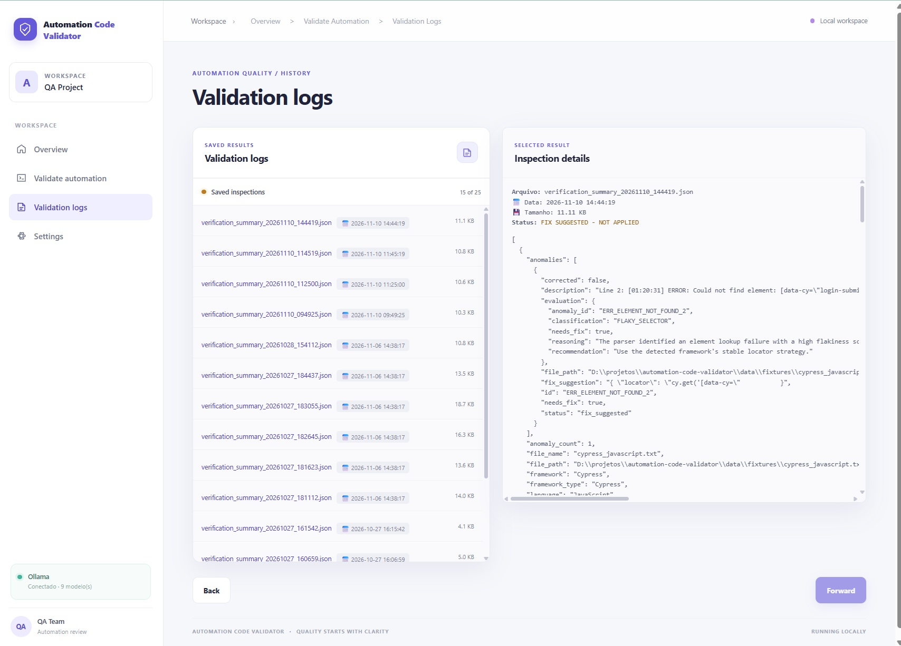
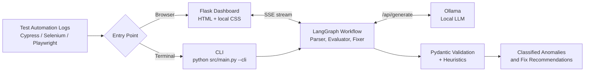
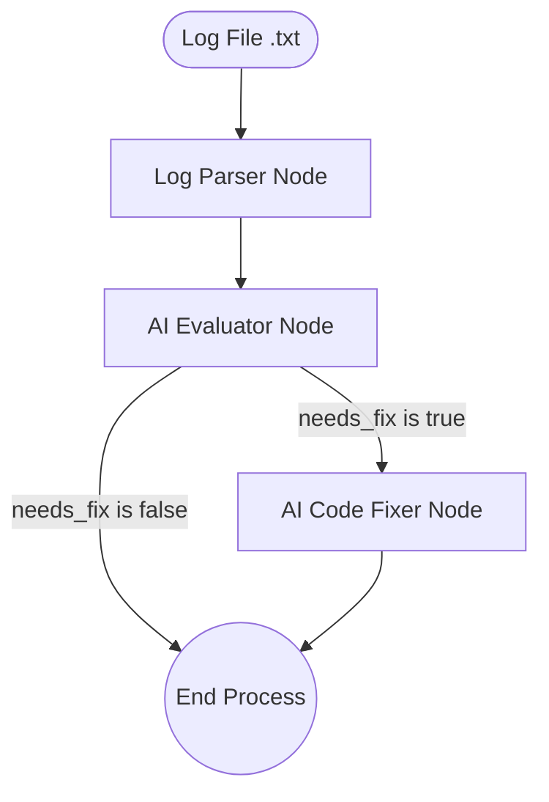

# 🧪 Automation Code Validator: AI Agent for Cypress, Selenium & Playwright Log Analysis


An intelligent, **AI-powered Flask dashboard** driven by an **agentic workflow (LangGraph)** to analyze, classify, and suggest fixes for **browser test automation logs**.

By leveraging **local LLM execution with Ollama** and stateful workflows, it automatically identifies the test framework (**Cypress, Selenium, Playwright**), isolates anomalies such as **flaky tests and ambiguous selectors**, and generates targeted, non-destructive debugging recommendations. Built for **QA engineers, SDETs and test automation teams** who need AI-assisted log triage without sending sensitive data to external APIs.

<div align="center">
  
</div>

## 🖥️ Dashboard Screens

<div align="center">
  
  
</div>

---

## 🗺️ Quick Navigation

* [Key Features & Business Value](#-key-features--business-value)
* [Technology Stack](#%EF%B8%8F-technology-stack)
* [Supported Frameworks](#-supported-frameworks--ecosystem)
* [System Architecture](#-system-architecture)
* [Agentic Workflow (LangGraph)](#-agentic-architecture-langgraph-workflow)
* [Getting Started](#-getting-started)
* [Testing and Code Quality](#-testing-and-code-quality)
* [Project Structure](#-project-directory-structure)

---

## 🚀 Key Features & Business Value

* **Stateful Agentic Workflow:** Built with **LangGraph** to process logs through a strict linear pipeline with conditional edge execution (Parser ➔ Evaluator ➔ Fixer).
* **Privacy-First Local AI:** Seamlessly integrates with **Ollama** (`/api/generate`) to run open-source LLMs locally, ensuring data compliance and zero API costs.
* **Real-Time Inspection Streaming:** Utilizes **Server-Sent Events (SSE)** via Flask to push asynchronous backend validation tokens and graph stages straight to the UI.
* **Deterministic Validation:** Combines **Pydantic** schemas with heuristics to override raw LLM outputs, guaranteeing precise event tracking and safe structural classification.

---

## 🛠️ Technology Stack

* **Backend Architecture:** Python 3.10+, Flask, Requests.
* **AI & Orchestration:** LangGraph, Pydantic, Ollama.
* **Frontend Experience:** HTML5, vanilla JavaScript, and responsive local CSS with light/dark/system themes.
* **Quality Assurance & Tooling:** Unittest (automated testing), Ruff (fast linting).

---

## 📊 Supported Frameworks & Ecosystem

| Framework | Languages Supported | Default / Fallback Behavior |
| :--- | :--- | :--- |
| **Cypress** | JavaScript | Defaults to JS if no explicit metadata is present. |
| **Selenium** | Java, JavaScript, Python | Strict mapping based on log signatures & file extensions. |
| **Playwright** | Java, JavaScript, Python | Detects environment signatures; avoids guessing unknown stacks. |

> **Note:** Each log file (`.txt`) is scoped and processed independently inside the workflow to ensure data isolation and prevent framework context pollution.

---

## 🧭 System Architecture



---

## 📐 Agentic Architecture (LangGraph Workflow)



1. **Parser:** Extracts anomalies, isolates infrastructure errors, and detects environment profiles.
2. **Evaluator:** Evaluates log anomalies using structured prompts. Outputs strict JSON verified via Pydantic.
3. **Fixer:** Executes only under `ERR_AMBIGUOUS_SELECTOR` or `FLAKY_SELECTOR` classifications. Generates exact non-destructive locator recommendations (`NO_SAFE_FIX` applied if context is ambiguous).

---

## 💻 Getting Started

### 1. Installation

Clone the repository and install the runtime dependencies inside a virtual environment (PowerShell):

```powershell
git clone https://github.com/acorvello/automation-code-validator.git
cd automation-code-validator
python -m venv .venv
.\.venv\Scripts\Activate.ps1
python -m pip install -e .
```

### 2. Configuration

Adjust your environment parameters inside `conf/config.json`:

```json
{
  "ai": { "preferred_model": "ollama" },
  "ollama": {
    "host": "http://localhost:11434",
    "model": "your-installed-model:tag"
  },
  "files": { "input_path": "data/fixtures" },
  "prompts": {
    "evaluator": "src/agents/prompts/evaluator_prompt.txt",
    "fixer": "src/agents/prompts/fixer_prompt.txt"
  }
}
```

### 3. Execution

To run the Flask Dashboard UI:

```powershell
python web_ui/app.py
```

Alternatively, use the automated Windows batch script launcher: `server/start_server.cmd`.
The launcher prefers the project `.venv`, checks the application dependencies, and serves the dashboard on `127.0.0.1:5000`. The Flask development server is intended for local use only; it is not configured for network or production deployment.

To run the pipeline strictly from the command line interface (CLI):

```powershell
python src/main.py --cli
```

---

## 🧪 Testing and Code Quality

Run the comprehensive unit test suite covering schema serialization, graph state transitions, client timeouts, and SSE stream chunking:

```powershell
python -m unittest discover -s src/tests -v
```

---

## 📁 Project Directory Structure

```text
conf/config.json                 # Application configuration profile
src/main.py                      # Core LangGraph compilation and CLI handler
src/agents/nodes/                # Independent agent logic (Parser, Evaluator, Fixer)
src/agents/prompts/              # Externalized plain-text system prompts
src/core/                        # Shared graph states and Pydantic schemas
src/utils/                       # Tech detection engine, HTTP clients, configuration loaders
src/tests/                       # Automated unit tests and mock fixtures
web_ui/app.py                    # Flask server endpoints and SSE event emitters
web_ui/templates/index.html      # Responsive dashboard interface
web_ui/static/styles.css         # Local visual design system and theme styles
logs/                            # Context-isolated inspection JSON summaries
server/start_server.cmd          # Native Windows orchestration script
```

---

## 👤 Author

**Alexsander Corvello da Silveira** — Senior QA Engineer focused on AI-driven testing and applied machine learning.
GitHub: [@acorvello](https://github.com/acorvello)
